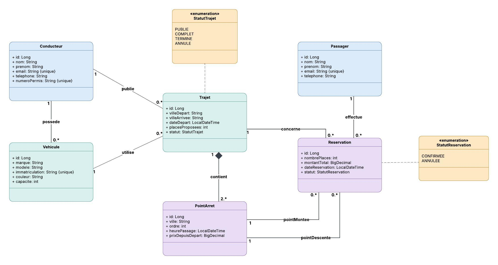
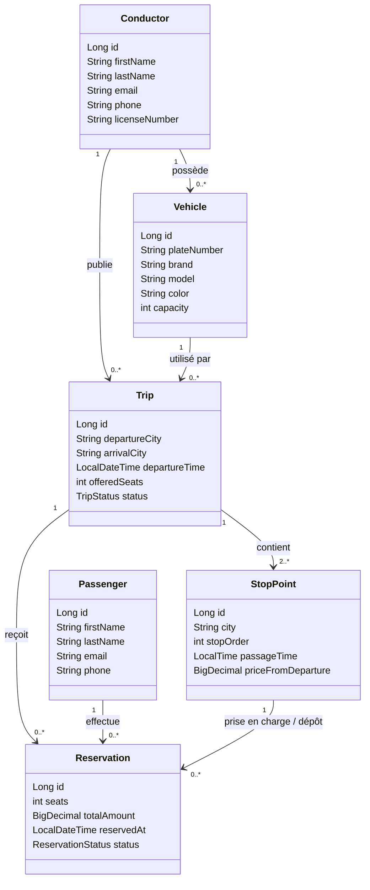

# DriveSpace

API REST de covoiturage multi-étapes développée avec Spring Boot. Elle permet de publier des trajets avec plusieurs points d'arrêt, de réserver un segment entre deux villes, et de gérer les conducteurs, passagers et véhicules.

## Fonctionnalités

- **Gestion des conducteurs** : CRUD et recherche par nom ou email (partielle, insensible à la casse).
- **Gestion des passagers** : CRUD, recherche par nom ou email, historique des réservations.
- **Gestion des véhicules** : CRUD, réservé à chaque conducteur via l'en-tête `X-Conductor-Id`.
- **Trajets multi-étapes** : publication avec points d'arrêt ordonnés, prix cumulé depuis le départ.
- **Recherche de trajets** :
  - par villes de départ/arrivée avec pagination et filtre par date ;
  - en une seule requête JPQL, entre deux arrêts quelconques du parcours, avec calcul du prix du segment et des places restantes.
- **Réservations** : calcul automatique du prix du segment, vérification des places, annulation souple (statut `ANNULEE`), annulation d'un trajet par son conducteur (statut `ANNULE`).
- **Gestion centralisée des erreurs** : réponses `ProblemDetail` (RFC 9457) et logs SLF4J.

## Stack technique

| Technologie | Version / usage |
|---|---|
| Java | 17 |
| Spring Boot | 4.1.2 |
| Spring Web MVC | API REST |
| Spring Data JPA / Hibernate | Persistance |
| PostgreSQL | Base de données |
| MapStruct | Mapping entités ↔ DTO |
| Lombok | Getters/setters, constructeurs, `@Slf4j` |
| Bean Validation | Validation des DTO |
| Maven Wrapper | Build (`./mvnw`) |
| Docker Compose | PostgreSQL local |
| JUnit 5 / Mockito | Tests unitaires |

## Structure du projet

```
src/main/java/ma/youcode/driveSpace/
├── controller/     # Endpoints REST (5 contrôleurs)
├── dto/            # Objets de requête et de réponse
├── entities/       # Entités JPA (6 entités)
├── enums/          # TripStatus, ReservationStatus
├── exception/      # Exceptions métier + GlobalExceptionHandler
├── mapper/         # Mappers MapStruct
├── repository/     # Repositories Spring Data JPA
├── service/        # Interfaces et implémentations métier
└── DriveSpaceApplication.java

src/main/resources/application.yaml
src/test/java/...            # Tests de service (JUnit 5 + Mockito)
diagram.jpeg                 # Diagramme de classes
compose.yaml, Dockerfile     # Docker
```

## Diagramme de classes

Le diagramme original du projet :



### Le modèle en bref

| Entité | Champs principaux | Relations |
|---|---|---|
| **Conductor** | `id`, `firstName`, `lastName`, `email`, `phone`, `licenseNumber` | `1—N` véhicules, `1—N` trajets |
| **Vehicle** | `id`, `plateNumber`, `brand`, `model`, `color`, `capacity` | `N—1` conducteur, `1—N` trajets |
| **Trip** | `id`, `departureCity`, `arrivalCity`, `departureTime`, `offeredSeats`, `status` | `N—1` conducteur, `N—1` véhicule, `1—N` points d'arrêt |
| **StopPoint** | `id`, `city`, `stopOrder`, `passageTime`, `priceFromDeparture` | `N—1` trajet |
| **Passenger** | `id`, `firstName`, `lastName`, `email`, `phone` | `1—N` réservations |
| **Reservation** | `id`, `seats`, `totalAmount`, `reservedAt`, `status` | `N—1` passager, `N—1` trajet, `N—1` point de prise en charge, `N—1` point de dépôt |

Points importants du modèle :

- `Trip` ne possède **pas** de collection de réservations : la relation est portée uniquement par `Reservation.trip`. Les réservations d'un trajet se récupèrent via `ReservationRepository`.
- `Trip.stopPoints` et `Conductor.vehicles` sont des collections inverses (`@OneToMany(mappedBy = ...)`).
- Les statuts sont stockés en chaînes : `TripStatus` (`PUBLIE`, `COMPLET`, `TERMINE`, `ANNULE`) et `ReservationStatus` (`CONFIRMEE`, `ANNULEE`).
- Les annulations sont souples : aucune suppression physique, seul le statut change.

### Version textuelle (Mermaid)



## Démarrage

### Prérequis

- JDK 17
- Docker et Docker Compose (pour PostgreSQL)
- Un fichier `.env` à la racine, ignoré par Git :

```properties
DB_PASSWORD=votre_mot_de_passe
```

### Base de données

```bash
docker compose up -d
```

PostgreSQL est exposé sur `localhost:5433` (base `driverSpace`, utilisateur `kaiser`, mot de passe `DB_PASSWORD`). `application.yaml` utilise l'hôte `postgres`, qui est résolu uniquement depuis le réseau Docker.

### Lancer l'application

Avec Docker :

```bash
docker build -t drivespace .
docker run -p 8081:8081 --env-file .env drivespace
```

En local, il faut surcharger l'URL de la base et le port (l'hôte `postgres` n'existe pas hors Docker) :

```bash
./mvnw -o spring-boot:run \
  -Dspring-boot.run.arguments="--server.port=8082 \
  --spring.datasource.url=jdbc:postgresql://127.0.0.1:5433/driverSpace \
  --spring.datasource.password=$DB_PASSWORD"
```

L'API répond alors sur `http://localhost:8082`.

## API REST

### Convention d'identité

Il n'y a pas d'authentification : l'identité est transmise explicitement.

- Les conducteurs et passagers sont identifiés par query param (`conductorId`, `passengerId`) ou par le corps de la requête.
- Les véhicules utilisent l'en-tête **`X-Conductor-Id`**, obligatoire sur tous les endpoints `/api/vehicles`. Un conducteur ne voit et ne modifie que ses propres véhicules ; tout autre véhicule retourne `403`.

### Endpoints

**Conducteurs — `/api/conductors`**

| Méthode | Chemin | Description |
|---|---|---|
| `GET` | `/api/conductors` | Tous les conducteurs |
| `GET` | `/api/conductors/search?name=&email=` | Recherche partielle et insensible à la casse |
| `GET` | `/api/conductors/{id}` | Détail |
| `POST` | `/api/conductors` | Création |
| `PUT` | `/api/conductors/{id}` | Modification |
| `DELETE` | `/api/conductors/{id}` | Suppression (refusée s'il possède des véhicules) |

**Passagers — `/api/passengers`**

| Méthode | Chemin | Description |
|---|---|---|
| `GET` | `/api/passengers` | Tous les passagers |
| `GET` | `/api/passengers/search?name=&email=` | Recherche partielle et insensible à la casse |
| `GET` | `/api/passengers/{id}` | Détail |
| `POST` | `/api/passengers` | Création |
| `PUT` | `/api/passengers/{id}` | Modification |
| `GET` | `/api/passengers/{id}/reservations` | Historique des réservations |
| `DELETE` | `/api/passengers/{id}` | Suppression (refusée s'il a des réservations) |

**Trajets — `/api/trip`**

| Méthode | Chemin | Description |
|---|---|---|
| `GET` | `/api/trip` | Tous les trajets |
| `GET` | `/api/trip/{id}` | Détail |
| `GET` | `/api/trip/search` | Recherche par `ville_depart`, `ville_arrive`, `date`, `page`, `size` |
| `GET` | `/api/trip/search/segment` | Recherche entre deux arrêts : `fromCity`, `toCity`, `dayStart`, `seats`, `maxPrice`, `page`, `size` |
| `POST` | `/api/trip` | Publication avec points d'arrêt |
| `DELETE` | `/api/trip/{id}` | Suppression (refusée s'il a des réservations) |
| `PATCH` | `/api/trip/{id}/cancel?conductorId=` | Annulation par le conducteur propriétaire |

**Réservations — `/api/reservations`**

| Méthode | Chemin | Description |
|---|---|---|
| `GET` | `/api/reservations` | Toutes les réservations |
| `GET` | `/api/reservations/{id}` | Détail |
| `GET` | `/api/reservations/passenger/{passengerId}` | Réservations d'un passager |
| `POST` | `/api/reservations` | Réservation d'un segment |
| `PATCH` | `/api/reservations/{id}/cancel?passengerId=` | Annulation par le passager propriétaire |

**Véhicules — `/api/vehicles`** (en-tête `X-Conductor-Id` requis)

| Méthode | Chemin | Description |
|---|---|---|
| `GET` | `/api/vehicles` | Véhicules du conducteur |
| `GET` | `/api/vehicles/{id}` | Détail (si propriétaire) |
| `POST` | `/api/vehicles` | Création pour le conducteur de l'en-tête |
| `PUT` | `/api/vehicles/{id}` | Modification (si propriétaire) |
| `DELETE` | `/api/vehicles/{id}` | Suppression (si propriétaire et non utilisé par un trajet) |

### Gestion des erreurs

`GlobalExceptionHandler` centralise les réponses au format `ProblemDetail` :

| Code | Titre | Cas |
|---|---|---|
| `400` | `Bad request` | Paramètres invalides, JSON malformé, en-tête manquant, validation des DTO |
| `403` | `Forbidden` | Tentative de gestion d'une ressource appartenant à un autre conducteur/passager |
| `404` | `Not found` | Ressource inexistante ou route inconnue |
| `405` | `Method not allowed` | Méthode HTTP non supportée |
| `409` | `Conflict` | Règle métier violée : doublon, places insuffisantes, suppression impossible |
| `415` | `Unsupported media type` | `Content-Type` incorrect |
| `500` | `Internal server error` | Erreur inattendue (journalisée en `ERROR`) |

## Tests

Les tests unitaires des services utilisent JUnit 5 et Mockito (32 tests) :

```bash
./mvnw -o test -Dtest=TripServiceImplTest,ReservationServiceImplTest
```

Le test `DriveSpaceApplicationTests.contextLoads` charge le contexte complet : il nécessite que l'hôte `postgres` soit résolvable (donc le réseau Docker) et échoue en exécution locale hors Compose.

## Suivi

Les tickets sont suivis dans le projet Jira **DRIV** (`DRIV-1` à `DRIV-17`), de l'epic initiale à la restriction de gestion des véhicules par conducteur.
